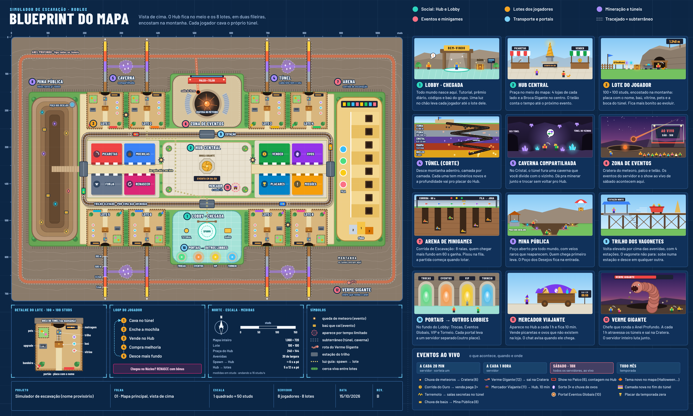

# Blueprint do mapa: simulador de escavação



Mapa visto de cima, retangular e compacto, com um desenho de referência para cada área. O Hub fica no meio e os 8 lotes ficam em duas fileiras encostadas na montanha. Cada jogador cava o próprio túnel.

A régua em volta do mapa marca os studs (1 quadrado = 50 studs). O mapa inteiro tem 1.068 × 720 studs.

## Onde fica cada coisa

| # | Área | Onde | O que tem |
|---|---|---|---|
| 1 | Lobby · Chegada | Meio da fileira de baixo, colado no Hub | Spawn, tutorial, prêmio diário, códigos e baú do grupo. Uma luz no chão leva cada jogador até o lote dele |
| 2 | Hub Central | Meio do mapa (praça de 240 × 144) | Broca Gigante com o telão do próximo evento. 4 lojas de cada lado: Picaretas, Mochilas, Forja e Renascer à esquerda; Vender, Ovos, Placares e Missões à direita |
| 3 | Lotes (8) | Duas fileiras de 4, em cima e embaixo do Hub | 100 × 100 studs: placa com o nome, baú, vitrine, pets, bancada de upgrade e a boca do túnel no fundo |
| 4 | Túneis | Saem do fundo de cada lote, montanha adentro | Camadas Terra, Pedra, Cristal, Magma e Núcleo |
| 5 | Cavernas compartilhadas | Na camada Cristal, entre dois lotes vizinhos | Os túneis dos dois vizinhos se encontram |
| 6 | Zona de Eventos | Meio da fileira de cima, de frente pro Hub | Cratera do meteoro, palco, telão e arquibancada |
| 7 | Arena de Minigames | Lado direito | Corrida de Escavação (8 raias), fila e pódio |
| 8 | Mina Pública | Lado esquerdo | Poço aberto com veios raros que reaparecem e o Poço dos Desejos |
| 9 | Trilho dos Vagonetes | Volta elevada por cima das avenidas | 4 estações: Eventos, Lobby, Mina e Arena |
| 10 | Portais | Fundo do Lobby | Trocas, Eventos Globais, VIP e Torneio. Cada um leva a outro place |
| 11 | Mercador Viajante | Praça do Hub, a cada 1 h | Itens raros por 10 min |
| 12 | Verme Gigante | Anel Profundo, sai na Cratera | Chefe a cada 1 h, o servidor inteiro luta junto |

O Anel Profundo é um túnel que dá a volta no mapa inteiro, na camada Magma, e liga todos os túneis.

Distâncias a pé (16 studs/s): do spawn ao Hub dá uns 6 s, e do Hub aos lotes, de 5 a 12 s.

## Eventos ao vivo

| Quando | Onde | O quê |
|---|---|---|
| A cada 20 min (sorteia um) | Servidor | Chuva de meteoros, Corrida do Ouro (venda 2×), terremoto (salas secretas no túnel), chuva de baús na Mina Pública |
| A cada 1 h | Servidor | Verme Gigante e Mercador Viajante |
| Sábado, 18h | Todos os servidores | Show no palco com contagem no telão do Hub, sorte 3× e chuva de ovos |
| Todo mês | Temporada | Tema novo no mapa, camada nova no fim do túnel, placar da temporada zera |

## Editar a imagem

Os nomes, as posições e os textos estão em `gerar_blueprint.mjs`. Para gerar de novo:

```
npm install
npx playwright install chromium
npm run gerar
```
