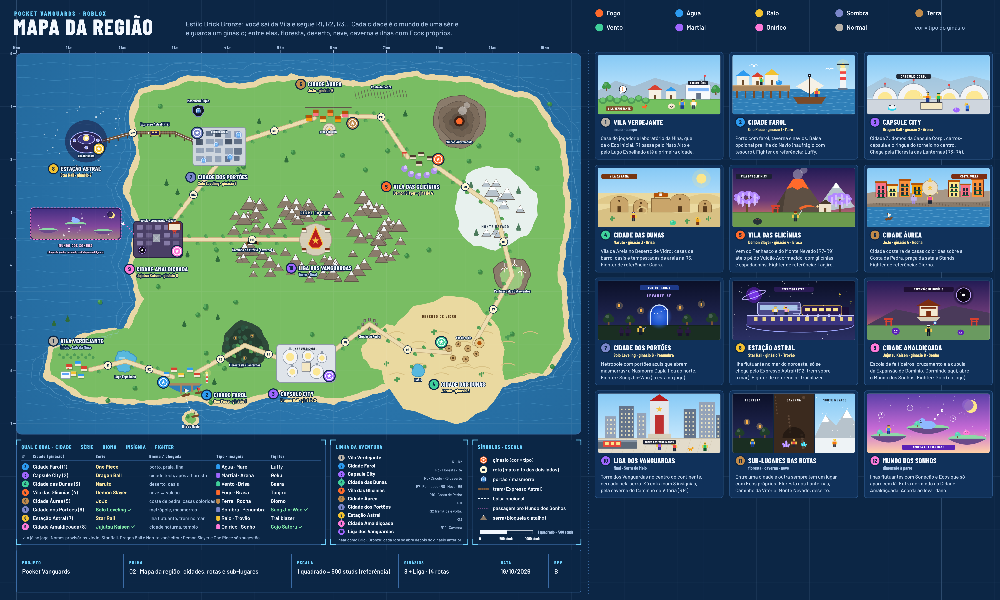

# Mapa da região: Pocket Vanguards



Região do Pocket Vanguards vista de cima, no estilo Pokémon Brick Bronze: você sai da Vila Verdejante e segue R1, R2, R3… Cada cidade é o mundo de uma série e guarda um ginásio. Entre uma cidade e outra tem um sub-lugar com Ecos próprios (lago, floresta, círculo de pedra, deserto, penhasco, montanha de neve, costa de pedra, masmorra, caverna, ilha) e um bioma diferente. O enquadramento é o mesmo do blueprint do simulador: mapa à esquerda, um desenho por lugar à direita, tabela "qual é qual", linha da aventura e símbolos embaixo.

Todos os nomes de cidade são provisórios. JoJo, Star Rail, Dragon Ball (Capsule City = cidade 3) e Naruto foram citados por você; Jujutsu Kaisen e Solo Leveling já estão no jogo; Demon Slayer e One Piece são sugestão para fechar os 8 ginásios.

## Linha da aventura

| # | Lugar | Série | Bioma | Tipo · insígnia | Fighter de referência | Chegada |
|---|---|---|---|---|---|---|
| 1 | Vila Verdejante | início | campo | Normal | — | Lab da Mina, Mato Alto |
| — | Lago Espelhado | sub-lugar | lago | — | — | R1 → R2 |
| 2 | Cidade Farol (ginásio 1) | One Piece | porto, praia | Água · Maré | Luffy | balsa opcional para a Ilha do Navio |
| — | Floresta das Lanternas | sub-lugar | floresta escura | — | — | R3 → R4 |
| 3 | Capsule City (ginásio 2) | Dragon Ball | cidade tech, domos da Capsule Corp., ringue | Martial · Arena | Goku | R4 |
| — | Círculo de Pedra, Deserto de Vidro, Oásis | sub-lugares | deserto | — | — | R5 → R6 |
| 4 | Cidade das Dunas (ginásio 3) | Naruto | vila de areia | Vento · Brisa | Gaara | R6 |
| — | Penhasco dos Cata-ventos, Monte Nevado | sub-lugares | penhasco, neve | — | — | R7 → R8 → R9 |
| 5 | Vila das Glicínias (ginásio 4) | Demon Slayer | pé do Vulcão Adormecido, glicínias | Fogo · Brasa | Tanjiro | R9 |
| — | Costa de Pedra | sub-lugar | penhascos no mar | — | — | R10 |
| 6 | Cidade Áurea (ginásio 5) | JoJo | cidade costeira colorida, praça da seta | Terra · Rocha | Giorno | R10 |
| 7 | Cidade dos Portões (ginásio 6) | Solo Leveling ✓ | metrópole com portões azuis, Masmorra Dupla | Sombra · Penumbra | Sung Jin-Woo ✓ | R11 |
| 8 | Estação Astral (ginásio 7) | Star Rail | ilha flutuante no mar | Raio · Trovão | Trailblazer | R12, Expresso Astral (trem sobre o mar, ida e volta) |
| 9 | Cidade Amaldiçoada (ginásio 8) | Jujutsu Kaisen ✓ | cidade noturna, escola, cúpula do domínio | Onírico · Sonho | Gojo Satoru ✓ | R13 |
| — | Mundo dos Sonhos | dimensão à parte | ilhas flutuantes | Onírico | — | dormindo na Cidade Amaldiçoada |
| — | Caminho da Vitória | sub-lugar | caverna na Serra do Meio | — | — | R14, só com 8 insígnias |
| 10 | Liga dos Vanguardas | final | Torre dos Vanguardas no centro | — | — | R14 |

Cada rota só abre depois do ginásio anterior. A Serra do Meio bloqueia o atalho até a Liga.

## Escala

1 quadrado da grade = 50 unidades = 500 studs (referência, não tamanho final). A região inteira dá uns 10,7 × 7,2 km.

## Trocar uma série ou um nome

Está tudo em `gerar_continente.mjs`: nomes e séries em `SERIES` (rótulos do mapa), `CARDS` (cards da direita) e nas tabelas de `insetTable()` e `insetLine()`. As posições das cidades ficam em `CITY`, os sub-lugares em `SUB` e as rotas em `ROUTES`.

## Gerar de novo

```
npm install
npx playwright install chromium
npm run gerar
```
